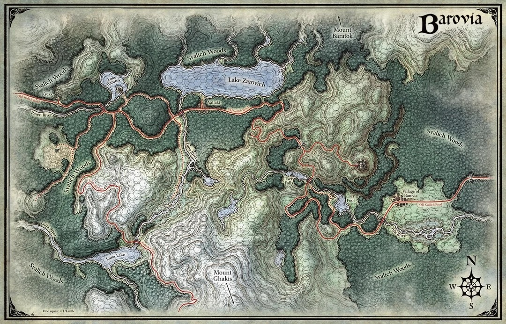
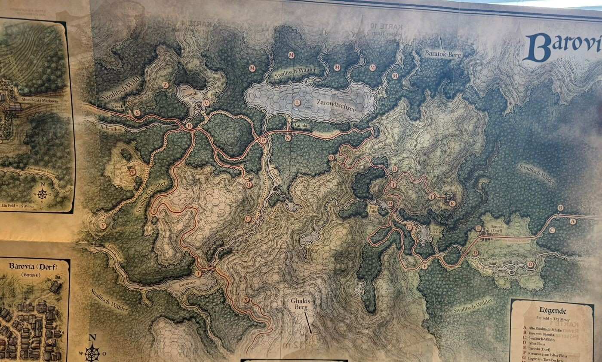
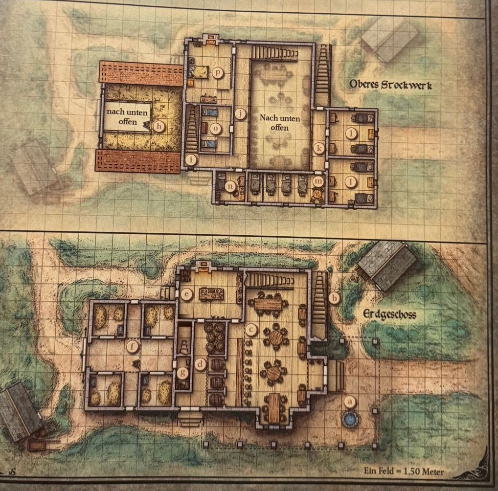

# Session 006 – Alles wird gut
**Datum:** 2026-10-11
**DM:** Jana
**Ort in der Spielwelt:** Verlassene Festung → Swalitsch-Straße (Bergpfad, Abzweig zur Windmühle) → Wald vor Vallaki → Vallaki: Stadttor → Marktplatz → Gasthaus Blauwasser

**Bilder:**

---

## Zusammenfassung
Raus aus der Festung, rein in den Regen: Moxie sitzt wieder bei der Party, die Windmühle bleibt links liegen, ein Jäger mit einem toten Wolf auf den Schultern rät zum Laufen. Kurz vor Vallaki versucht ein Rudel Schreckenswölfe, Irena in den Wald zu zerren — bis Feuerpfeile von der Palisade die Wölfe vertreiben. Hinter dem Tor: eine Stadt, die lächeln muss. Lila Schleifen, Eselsmasken am Pranger, jede Woche „das größte Fest des Jahres". Im Gasthaus Blauwasser findet die Party Wärme, Wolfseintopf, einen neugierigen Barden namens Rictavio — und die Warnung vor Isek Strazni, dem „Lilanen" mit dem Stachelarm, der sich auffällig für Irena interessiert.

---

## Die Party
| Spieler | Charakter | Rasse | Klasse | Level |
|---------|-----------|-------|--------|-------|
| Raffi | [Nia Sommerfeld](../../../charaktere/nia-sommerfeld/charakterbogen.md) | Mensch | Bard (College of Dance) | 4 |
| Felix | [Florpthyz Dread](../../../charaktere/florpthyz-dread/charakterbogen.md) | Gnom/Standuhr | Fighter (Eldritch Knight) | 3 |
| Andi | [Alberich von Steinkreis](../../../charaktere/alberich/charakterbogen.md) | Zwerg | Cleric (Domain of Light) | 3 |
| Tom | [Thorin](../../../charaktere/thorin/charakterbogen.md) | Eisbär (Nordvolk) | Barbarian | 3 |
| Svenja | [Moxie](../../../charaktere/moxi/charakterbogen.md) | Goblin | Ranger (Monster Slayer) | 3 |
| Anna | [Mara Winterried](../../../charaktere/mara/charakterbogen.md) | Mensch | Bard | 3 |

*(Reist mit: [Irena Koljana](../npcs/irena-koljana.md) — Ziel Vallaki, dort sicher unterbringen.)*

---

## Was passiert ist

### Aufbruch im Regen
> Die lange Rast ist vorbei, Irena drängt: Vallaki noch vor der Nacht. Draußen drückt der Nebel auf die Stimmung, dann beginnt es zu schütten.

*[alle]*

Die Unholde sind tot, die Fledermaus ist weg, die Nacht im Thronsaal ist überstanden. [Irena](../npcs/irena-koljana.md) ist dankbar — aber sie will **heute noch, bevor es dunkel wird, in Vallaki ankommen**. Bitte. Jetzt.

**Mara** nimmt sich vorher noch **Flori** zur Brust: Er geht **nicht mehr** zu irgendwelchen komisch aussehenden Türmen. Flori: *„Kann ich nicht versprechen. Ich bin einfach grundauf fasziniert von Türmen."* Nia fragt laut, ob jemand eine Leine dabeihat.

Die Party verlässt die [verlassene Festung](../orte/verlassene-festung.md) durch das Seitenschiff. Alles ist wieder neblig und feucht, und dann fängt es auch noch richtig an zu **regnen**. Es platscht, es tropft, es ist unangenehm — selbst für den Bären, der ohnehin nass ist. *(„Hier riecht's nach nassem Hund.")*

### Moxie im Baum
> Auf dem Weg zur Straße steigt Moxie von einem Baum: Sie hat allein die Nacht im größten Wipfel verbracht. Zähne-Check, ein Tropfen Weihwasser — nichts. Das war ein Zauber.

*[alle]*

[Moxie](../../../charaktere/moxi/charakterbogen.md) hat ihr Kloster in der Natur gefunden: Sie ist auf den **größten Baum** geklettert, den sie finden konnte, und hat dort ihre lange Rast gemacht. Jetzt kommt sie herunter, als die Party vorbeizieht.

Thorin: *„Zeig mal die Zähne."* Moxie zeigt sie — keine Fänge. *„Soll ich noch ein Stück Knoblauch essen?"* **Alberich** nimmt ihre Hand und lässt einen Tropfen **Weihwasser** darauf fallen. Kein Zischen, kein Dampf, nichts. Alles gut. *(Nia: Weihwasser im strömenden Regen — und ob Alberich nicht gleich den ganzen Regen weihen könne? Nicht in seiner Macht.)*

Moxie selbst kann es noch nicht fassen: *„Er hat gesagt, er ist mein Freund — und ich hab ihm geglaubt."* Für die Party ist die Sache klar: **Das war ein Zauber**, nicht Moxie.

Die Karte trägt **Alberich**, der Navigator der Gruppe. Es gibt im Moment ohnehin nur **einen** Weg: zurück auf die Swalitsch-Straße, Richtung Vallaki.

### Der Blick auf Vallaki
> Der Pfad schmiegt sich eng an eine Bergflanke; unten im Tal liegt eine ummauerte Stadt am dunklen See — und der Nebel kommt nicht hinein.

*[alle]*

Die Swalitsch-Straße wird immer schmaler, bis sie nur noch ein **Pfad an der Bergflanke** ist — einer hinter dem anderen, Wasser tropft von oben, alles ist dunkel und nass. Dann öffnet sich der Blick ins Tal:

Eine **ummauerte Stadt** nahe dem Ufer eines **großen Bergsees**. Das Wasser ist **unglaublich dunkel**. Und der **Nebel** liegt überall — **nur nicht in der Stadt**. Es sieht aus, als würde er versuchen hineinzukriechen, und es nicht ganz schaffen. Das ist **[Vallaki](../orte/vallaki.md)**.

Irena erzählt, was man sich erzählt: Der **Baron**, der Bürgermeister der Stadt, **feiert Feste** — Freude gegen das Übel, gegen Strahd. Vallaki **wehrt sich**. Deshalb will sie dorthin.

Mara erinnert sich, dass die Vistani mit Strahd zumindest diplomatisch auskommen. Irena relativiert: **Nicht alle Vistani** stehen zu Strahd, manche sind gegen ihn — aber es gibt **Spione Strahds**, unter den Vistani wie unter ganz normalen Barovianern. *„Wir wissen nie, wer Freund und wer Feind ist."*

### Die Windmühle am Abzweig
> An einer Gabelung zweigt links ein Weg auf den Berg ab, oben steht eine verrottete Windmühle — genau der Ort, vor dem Madame Eva gewarnt hat. Die Party diskutiert viel zu lange, dann geht Thorin einfach weiter.

*[alle]*

Nach einer Weile: ein **Abzweig**. Links geht es hinauf auf den Berg, der die ganze Zeit neben der Party lag; der eigene Weg macht eine kleine Rechtskurve. Oben auf dem Berg steht eine **alte, verrottete [Windmühle](../orte/windmuehle.md)**: gemauert, mit **Zwiebelkappe** obendrauf, unten ausladend „wie ein Kleid". Die **Flügel** sind morsch und zerfallen, hängen schief. Alles ist dreckig, mit **Moos** und **Efeu** überwuchert.

**Nia:** *„Moment — irgendwas war doch mit Windmühle."* Richtig: **Nicht zur Windmühle.** Flori: *„I feel the call of the windmill."* Nia: *„Pfui, aus! Böser Flori."*

**Moxie** wirft einen genauen Blick hinauf: Auf der Windmühle springt eine **Ratte** hin und her. Thorin murmelt, ob man nicht doch hinmüsse. Irena fühlt sich hier gar nicht mehr wohl — sie würde sogar **Geld dafür geben**, dass die Party weitergeht.

**Nia:** *„Wieso diskutieren wir darüber, ob wir etwas machen, das uns ganz explizit von einer vertrauenswürdigen Person verboten wurde? Das ist die einzige vertrauenswürdige Person, die wir kennengelernt haben, seit dieser Scheiß-Nebel da ist."*

Am Ende entscheidet **Thorin** mit den Füßen: Er trottet einfach weiter auf dem normalen Weg Richtung Vallaki. Irena ist begeistert und nimmt **Nia an der Hand**. Thorin setzt sich **Moxie auf die Schultern**. **Mara** folgt, dreht sich aber immer wieder zur Mühle um. **Flori** läuft **rückwärts** — er sichert nach hinten.

### Der Wolfsjäger
> Ein großer, triefnasser Mann kommt entgegen, einen riesigen toten Wolf über den Schultern: „Die Wölfe des Teufels kreisen um die Straße. Wenn ihr nach Vallaki wollt — lauft."

*[alle]*

Von Thorins Schultern aus sieht **Moxie** ihn zuerst: in der Ferne ein **dunkel gekleideter Mann**, durchnässt, der einen **Wolfskadaver** trägt — von einem **riesengroßen Wolf**, die Beine mit je einer Hand gepackt, quer über die Schultern. Die Hände sind voll, also schon mal kein direkter Angriff.

Er trägt **kleine Embleme** an der Kleidung — dieser Mensch **hat eine Seele**. [Soldarovitsch](../npcs/soldarovitsch.md) (den Namen erfährt die Party erst abends im Gasthaus) bleibt kurz stehen, trieft und sagt:

> *„Die Wölfe des Teufels kreisen um die Straße. Wenn ihr nach Vallaki wollt — lauft. Dort ist alles gut. Dort ist alles gut. Alles, alles wird dort gut. Der Bürgermeister sorgt dafür."*

Und er? *„Ich muss noch ein paar Wölfe schießen."* Dann trottet er weiter, weg von der Stadt.

Mara grübelt hinterher, ob er mit „laufen" vielleicht **rennen** gemeint hat. Man geht ein bisschen schneller.

### Rudeltaktik
> Hecheln links und rechts im Wald, es werden mehr. Moxie warnt vor Rudeltaktik — dann bricht vor Alberich ein Schreckenswolf hervor, knurrt das Signal, und das Rudel kommt von allen Seiten.

*[alle]*

**Mara** hält sich am Straßenrand und lauscht in den Wald: **Hecheln** rechts und links, dazu leises **Knacken** von Ästen. Und je länger die Party unterwegs ist, desto mehr wird es.

**Moxie** kennt sich mit Viechern aus (Natur **24**): Wölfe jagen im **Rudel** und sind dann richtig gefährlich, weil sie **Rudeltaktiken** anwenden. Einzelne Wölfe sind kein Problem. Und: Wölfe **können nicht klettern**. Irena schätzt, es ist noch etwa **eine halbe Stunde** bis zur Stadt. Der Wald wird lichter, je schneller man geht.

Dann, direkt vor **Alberich**: Ein riesiger **Schreckenswolf** bricht hervor und **knurrt** — und das Knurren ist ein **Angriffssignal**. Von links und rechts der Straße brechen weitere Wölfe hervor; zwei springen von hinten auf **Flori** zu, der ja rückwärts läuft. Insgesamt **zwei Schreckenswölfe und fünf Wölfe**. Moxie schreit: *„Sie versuchen, uns einzukesseln!"*

**Mara** war gewarnt und reagiert sofort: **Sleep** auf den Leitwolf (Wis-SG 13) — er sackt weg.

### Sie wollen Irena
> Die Wölfe interessieren sich nur für eine: Sie reißen Irena um und zerren sie in Richtung Wald. Feuerwand im Kopf, Bär am Arm, Pfeil am Ohr — die Party kämpft um sie.

*[alle]*

Initiative. Ein Wolf springt Flori von hinten an. **Alberich** zieht Schild und — erstmals — das grün schimmernde [Langschwert +1](../items/langschwert-plus1-untote.md) und schlägt einen Wolf neben dem schlafenden Leitwolf (**18**, trifft). **Nia** schreit *„Flori, Vorsicht!"* (Bardische Inspiration für Flori), verfehlt einen Wolf mit der Faust und geht in **Defensive Stance** (*Blade Ward*). **Mara** rennt Richtung Stadt und beschimpft im Vorbeilaufen einen Wolf mit **Gehässigem Spott**.

Dann wird klar, worum es geht: Ein Wolf reißt **Irena** zu Boden. Der nächste **schnappt ihre Kleidung** und **zerrt sie Richtung Wald** — sechs, sieben Meter, dann noch einmal so viel. Die Wölfe haben scheinbar **kein Interesse an Nia** oder den anderen. Nur an Irena.

- **Moxie** wirkt **Zephyr Strike** auf sich selbst, flitzt ohne Gelegenheitsangriffe zu Irena und stellt sich zwischen Wolf und Wald.
- **Thorin** springt vor einen Schreckenswolf — Wölfe und Bären sind keine Freunde —, **brüllt ihn an** (Einschüchtern **17**, gelingt) und geht in **Rage**. Als der Leitwolf an ihm vorbei zu Irena will: Gelegenheitsangriff, **Natural 20**. Der Wolf schüttelt sich und zerrt trotzdem weiter.
- **Flori** legt die Tentakel auf einen Wolf, die Uhr glüht **dunkelrot** — **Burning Hands**: 17 Feuer, der Wolf **verbrennt**. Action Surge, Axt gegen den nächsten. Diesem Wolf schickt er telepathisch nur eins in den Kopf: **das Ticken der Uhr**. *(Floris persönlicher Kill-Count: angeblich vier.)*
- **Alberich** lässt das Schwert fallen, hält den Schild vor sich und brennt den Leitwolf mit **Burning Hands** an — der schüttelt sich. Der Leitwolf beißt zurück (7 Schaden) und **reißt Alberich um**.
- **Nia** sieht Irena davongezerrt werden und vergisst alles andere: *„Irena!"* — Flickflack quer übers Schlachtfeld. *„She's my friend! I'm gonna take care of her!"* Ein Wolf beißt ihr ins Bein (7 Schaden), sie geht zu Boden.
- **Mara** reißt sich ein Stück Stoff ab, zerreibt es zu Asche — und für den Leitwolf, **nur für ihn**, steht plötzlich eine **Feuerwand** zwischen ihm und dem Wald (*Trugbild*). Er hält sie für echt und verbrennt sich daran.
- **Moxie** markiert den Leitwolf mit **Hunter's Mark**: Aus einem winzigen **Blasrohr** pustet sie einen bunt leuchtenden Pfeil, der neben seinem Ohr landet und dort leuchtet. *(Nia: „GPS-Tracker.")*
- **Thorin** packt **Irena mit einer Hand** und rammt mit der anderen **Glühbert** ins Maul des Leitwolfs (**25**). Tauziehen: Bär gegen Wolf — **der Wolf gewinnt** und zerrt Irena um die Feuerwand herum. Gelegenheitsangriffe von allen Seiten, Moxie trifft mit allem, was sie hat: **Der Leitwolf bricht zusammen.**

### Feuerpfeile von der Palisade
> In der Ferne flammt die Palisade von Vallaki auf: Feuerpfeile regnen herab, die Wölfe fliehen. Zurück bleiben ein Schreckenswolf und ein toter Wolf.

*[alle]*

Flori sieht es zuerst: In der Ferne zeichnen sich plötzlich die **Palisaden** ab — weil dort **Feuer** entflammt. Von den Mauern werden **brennende Pfeile** geschossen, auf die Wölfe — und damit auch auf die Party. Die **Wölfe fliehen**. Liegen bleiben **ein Schreckenswolf und ein toter Wolf**.

Alberich brüllt eine Warnung und duckt sich unter seinen Schild. Moxie versteckt sich (Nimble Escape) unter dem Schreckenswolf und versucht nebenbei, ihm einen **Zahn** abzubrechen. Thorin geht hinter einem Baum in Deckung. **Flori** tanzt elegant durch den Pfeilhagel (Akrobatik **17**).

Nia bleibt einfach liegen — Priorität ist **Irena**. Die hat eine dicke Fleischwunde. **Healing Word, 13 HP** — Irena ist wieder voll da. Dann alle mit Irena an der Hand zum Tor.

### Das Tor von Vallaki
> Das Tor ist zu. Durch den Guckschlitz: „Die haben ein Tier dabei! Und eine Uhr!" — Irena nennt ihren Namen, Mara spielt Flöte, und die Party darf hinein. Unter Auflagen.

*[alle]*

Die **Stadttore sind zu**. Oben öffnet sich ein kleiner Schlitz. Die Wache ist nicht begeistert: *„Ey, ganz komisch, das Zeug da unten! Die haben ein **Tier** dabei! Eine **Uhr**! Und was ganz Kleines!"* Mara stellt vor: *„Das ist Thorin. Das ist Flori — wink mal, Flori!"* Alberich: *„Im Namen Helms, lasst uns ein."* Einen **Zwerg** hat die Wache noch nie gesehen — große Augen, Klappe zu.

Kurz darauf geht der Schlitz wieder auf, eine **andere, höhergestellte Wache** steht da. Irena tritt vor:

> *„Irena Koljana ist mein Name. Ich komme und ersuche eure Hilfe. Das sind meine getreuen Gefährten, die mich gerettet haben. Bitte, bitte, lasst uns ein."*

Die Wachen tuscheln. *Die Tochter des Bürgermeisters von Barovia?* **Mara** holt die **Flöte** raus und tanzt (Auftreten **16**). Vallaki habe zwar „schlechte Laune, keinen Platz" — aber gut. **Unter folgenden Bedingungen:**
1. **Keine Unruhe** stiften — sonst sofort wieder draußen.
2. **Alle** — bis auf die Dame — müssen am **Fest der brennenden Sonne** teilnehmen. **In drei Tagen.**
3. Das **Raubtier** muss eine **lila Schleife** tragen (*Paragraph 4, Absatz 2*) — und **es gehört geführt**, an einer **sichtbaren Leine**.

Thorin setzt sich die [lila Schleife](../items/lila-schleifen.md) auf den Kopf. **Moxie** nimmt die Leine und klettert wieder auf seine Schultern. Die Damen sollten außerdem **die Falten aus dem Gesicht** bekommen. *„Können wir alle noch einmal grinsen? Alles wird gut!"* — *„Alles wird gut."* Das **Tor** geht auf.

**Mara** hakt nach (Einsicht **21**): Das „Alles wird gut" ist **aufgesetzt**, eher ein Mantra. Alle Wachen tragen eine **lila Schleife um den Arm**. Mara wirft **Gedanken wahrnehmen** auf den Wachmann und hört: *„Jede Woche diese Feste … Ich muss mich natürlich überzeugen lassen, dass alles gut wird. Tolles Fest."*

Für die Tochter eines Bürgermeisters empfiehlt die Wache das **[Gasthaus Blauwasser](../orte/gasthaus-blauwasser.md)**: der Straße folgen, nie abbiegen, auf der rechten Seite. Großes Haus, Schild mit Wasser dran.

### Lächeln, bitte
> Vallaki grinst. Fast alle tragen lila Schleifen, am Marktplatz stehen Menschen mit Eselsmasken am Pranger — sie waren nicht glücklich genug.

*[alle]*

Auf dem Weg fällt allen auf, ganz ohne Wahrnehmungswurf: **Die Leute grinsen.** Ständig. Und **sehr viele** tragen etwas **Lilanes** — meist eine **Schleife um den Oberarm**, wie eine Manschette.

Am **Marktplatz** stehen Menschen mit **Eselsohren** oder ganzen **Eselsmasken** — und die schauen gar nicht glücklich. Einige stehen am **Pranger**. Alberich fragt einen grinsenden Passanten. Der rückt näher, damit er leise reden kann: *„Ihr müsst ein bisschen mehr lächeln. Es ist wichtig, dass man hier lächelt und glücklich ist. Und bloß nichts Negatives sagen."* Die am Pranger waren **zu unglücklich** — sie bleiben dort, **bis sie wieder sagen, dass sie glücklich sind**. *„Fragen Sie mich nicht. Ein bisschen mehr lächeln, bitte."*

Und die Schleifen? Ein Zeichen, dass man **den Baron unterstützt** und dass alle glücklich sind. *„Würde Ihnen fantastisch stehen."* An einem Stand liegen sie **kostenlos** aus. **Mara** holt für alle welche und steckt sie an — Hauptsache **sichtbar**. Flori bekommt seine an einen **Uhrzeiger** geknotet.

Irena weiß auch nichts über die Schleifen — sie war **selbst noch nie in Vallaki**. Sie weiß nur, dass sie in **bestimmten Häusern** sicher ist; auf Dauer sollte sie **in die Kirche**, dort sei sie sicher vor Strahds Blick — **morgen** will sie hin. Warum sie nicht zum Fest muss? *„Entschuldigung, bitte? Ich bin ja wohl hohen Standes."* Ihr Vater kannte den Baron, aber gesehen hat sie ihn kaum — da war sie noch ein kleines Mädchen.

### Gasthaus Blauwasser
> Ein großes, warmes Haus mit blauem Wasserfall auf dem Schild. Beim Eintreten verstummt der Raum — das Lauteste ist Floris Ticken. Dann klatscht der Wirt in die Hände.

*[alle]*

Das **Blauwasser** ist ein großes, **zweistöckiges Haus**. Vorne führt eine **Holztreppe** nach oben zu einer Tür im ersten Stock (zu). Geradeaus geht eine **Steintreppe** hinauf zum normalen Eingang im Erdgeschoss. Das Schild zeigt einen **blauen Wasserfall** und schwingt im Wind. Rauch steigt auf, drinnen wird gemurmelt — warm, trocken, Essen.

Als die Truppe eintritt: **Stille.** Gabeln bleiben in der Luft, alle starren — und das Lauteste im Raum ist das **Ticken** von Flori. Der Gastraum ist vollgestellt mit Tischen, hier trifft sich offenbar ganz Vallaki. Schräg gegenüber ein **langer Tresen**, darüber ein **Balkon** zu den Zimmern.

Hinter dem Tresen klatscht ein freundlicher Herr im **karierten Hemd** in die Hände — der Wirt, [Herr Martikov](../npcs/wirt-martikov.md): *„Na, das sieht ja aus nach Abenteurern, die den Nebel überlebt haben! Kommt doch gleich rein, bevor die Stiefel zu nass werden. Oder das Fell."* Er setzt die Party **hinten in die Ecke, direkt an den Kamin**. Das Klirren geht wieder los.

Seine Frau, **[Danina Martikov](../npcs/danina-martikov.md)** — ein bisschen mollig, sehr hübsch — bringt **Weingläser und einen Krug**. Übernachtung: **5 Silber pro Kopf und Nacht, Essen inklusive**. Sie hat schon gehört, was am Tor passiert ist: Wenn Mara heute Abend **etwas Leichtes** spielt, sind **Kost und Logis frei**. *„Alles in **Dur**, bitte. Bloß kein Moll. Die Leute hier brauchen ein Ventil, um ein bisschen **wirklich** glücklich zu sein. Sonst platzt unsere Stadt vor lauter erzwungenem Lächeln."*

Thorin: *„Ich bin ihr Haustier, ich muss nicht zahlen."* — *„Dann kriegst du auch keinen Wein."*

Leiser, zu **Thorin und Flori**: *„Ein großer Eisbär. Ein Wunderwerk der Technik. Ihr fallt auf wie ein Leuchtfeuer. Wenn euch die **Handlanger des Barons** bemerken, wollen sie, dass ihr beim Fest mitmacht — auf eine andere Art und Weise. Haltet die Köpfe unten und bleibt ruhig."* Zu **Moxie**, mit Zwinkern: Hier werde niemand nach seiner Rasse beurteilt — Hauptsache, die Finger bleiben aus den Taschen der Gäste.

Mit Edelsteinen kennt sich Danina nicht aus, aber **am Marktplatz** gebe es jemanden, der das tut. (Alberich, Zwerg, schätzt so einen Stein ohnehin auf rund 100 Gold.)

Und zu **Irena**: sofort ein Zimmer, ein Schlüssel, etwas zu essen. *„Lasst sie nicht aus den Augen. Hier drin ist sie sicher. Draußen jagen die Monster — hier drinnen jagen die Menschen. Sobald sie das Haus verlässt, darf sie **Strahds Spionen** nicht in die Hände fallen."*

Es gibt **zwei Einzelzimmer**: eins bekommt Irena, das andere ist belegt — von einem **sehr bunt gekleideten Herrn mit Federhut**, drüben am anderen Ende des Raums. Dazu ein Dreibettzimmer und Zweibettzimmer, die jetzt alle der Party gehören. Überall gibt es **schwere Fensterläden** mit großen Riegeln — das Haus wirkt sicher. Nias Plan, gleich das **ganze Gasthaus** zu mieten, damit sich kein Spion einmieten kann, erledigt sich durch Maras Musik-Deal. **Moxie** holt die Schlüssel.

**Alberich** hat Bedenken: Allein im Einzelzimmer kann niemand auf Irena aufpassen. Sein Vorschlag: Die drei Frauen — **Nia, Mara und Irena** — schlafen zusammen im **Dreibettzimmer**, und **er** nimmt Irenas Einzelzimmer. Sollte jemand dort nach ihr suchen: *Surprise.* **Moxie und Thorin** bekommen das Zweibettzimmer, **Flori** bleibt im Gang.

Zum Essen gibt es einen großen Topf **Wolfseintopf** — *„heute frisch geschossen von Soldarovitsch"*. Thorins Urteil: Wolf ist nicht ganz Fisch.

### Wortfetzen und ein Federhut
> Alberich schlendert an den Tischen vorbei und fängt Fetzen auf: der Baron rettet uns alle, Lady Wachter, ein gefährlicher „lila Knabe", verschwundene Menschen. Der Federhut-Herr schreibt alles mit.

*[Alberich, Flori, Thorin, Moxie]*

**Alberich** holt sich immer wieder auf Umwegen etwas vom Tresen und lauscht im Vorbeigehen:
- *„Der Baron rettet uns alle."*
- *„Beim Fest brennen die Sorgen."*
- **„Lady Wachter"** — aus einem anderen Gespräch, nur der Name.
- Die Leute reden über einen **lila Knaben**, der **gefährlich** ist. Und dass **Menschen verschwunden** sind — vermutlich seinetwegen.

Dabei fällt ihm (Wahrnehmung **16**) der **bunte Herr mit dem Federhut** auf: Er schaut immer wieder herüber und **schreibt ununterbrochen** in sein Notizbüchlein — nicht nur über die Party, er beobachtet den ganzen Raum, manche Leute mehr, manche weniger.

Alberich holt **zwei Krüge vom teuren Wein** (in Barovia gibt es nur Wein, mit Klappdeckel) und setzt sich zu ihm: Seine Gefährten seien schon im Bett, ob er Gesellschaft wolle? Der Herr mustert ihn: *„Du bist also auch einer von denen. Lila, alles wird gut, grinsen die ganze Zeit."* Er stellt sich vor: **[Rictavio](../npcs/rictavio.md).** Ihm hat gefallen, wie Alberichs Freundin am Tor gespielt hat; er selbst sei besser im **Geschichtenerzählen** als im Musizieren. Aktuell gehöre er zu keiner Truppe — *„wo mein Weg mich hintreibt"*. Er fühle sich hier wohl und werde **noch viel über diese Stadt herausfinden**. Die Notizen? *„Für meine zukünftigen Geschichten. Inspiration."* Alberich stößt immer wieder an; gesprächiger wird Rictavio dadurch kaum. Als Flori die Treppe herunterkommt, notiert er auch das.

**Flori** kommt nach unten (Thorin hat oben die Wache übernommen) und hört beim Vorbeigehen an einem Tisch einen Satz in der Art: *„Oh ja, dann muss es wohl mal wieder **Blitze und Schreie** geben."* Worum es ging, bleibt unklar.

**Moxie** sucht derweil den Abort — er ist **draußen**. Draußen laufen nur grinsende Menschen mit lila Schleifen vorbei: *„Guten Abend, guten Abend, guten Abend."*

### Das Gesicht im Fenster
> Thorin bewacht oben Irenas Tür und sieht plötzlich ein Gesicht am Fenster: jemand in Lila, im strömenden Regen, starrt suchend herein — und ist im Nebel verschwunden.

*[Thorin, Irena]*

**Thorin** liegt oben im Flur vor **Irenas Tür** und beobachtet den Gastraum. Aus dem Augenwinkel: Im **Fenster** des Gasthauses erscheint ein **Kopf**. Jemand **starrt sehr angestrengt herein**, sucht offensichtlich etwas. Ein Mensch, **sehr lila angezogen**, draußen im strömenden Regen. Dann ist er **im Nebel verschwunden**.

Thorin klopft bei Irena: *„Ist bei dir alles gut? Ist dein Fensterladen zu?"* — *„Nein."* — *„Stört es dich, wenn ich ihn zumache?"* — *„Nein. Dann kann ich auch gut schlafen."* Thorin geht rein, schließt den **Laden**, schiebt den **Riegel** vor, geht wieder raus und bewacht die Tür von außen.

### Der Mann mit dem Stachelarm
> Auf dem Weg zum Markt sehen Nia und Mara den Mann in Lila: Er starrt ins Gasthaus, geht — und sein linker Arm hat viel zu lange Finger mit Stacheln. Er schnippt, und Feuer springt heraus.

*[Nia, Mara]*

**Nia** und **Mara** sind unterwegs Richtung Markt (Irena bleibt im Zimmer — sie soll nicht erkannt werden). Nia schaut sich nach dem „Fenster-Typen" um — **Natural 20**.

Ein **Mann ungefähr in Irenas Alter**, etwas älter, läuft ganz normal die Straße entlang — **lila gekleidet**, nicht nur eine Armbinde, sondern eine **lila Weste**. Dann bleibt er stehen, als hätte er etwas bemerkt, geht zum Gasthaus, **starrt hinein**, und geht wieder. Er verschwindet im Nebel und Regen.

Was den beiden noch auffällt: Sein **linker Arm** ist **kein normaler Arm**. Die **Finger** sind **viel länger** als bei Menschen, unten dran sitzen **Stacheln**. Und sie sehen, wie er mit diesen Fingern **schnippt** — und **Feuer** herausschlägt.

*„Sieht so aus, als wäre es eine gute Idee gewesen, Irena da drin so einzupferchen."* — *„Nicht gut. Aber alles ist gut."*

### Der grüne Rubin
> Am Marktplatz werden die Plakate fürs „größte Fest des Jahres" gegen neue fürs nächste „größte Fest des Jahres" getauscht. Eine Händlerin mit riesigem Monokel kauft Nia einen grünen Rubin für 120 Gold ab.

*[Nia, Mara]*

Am **Marktplatz** wieder die Eselsköpfe — und überall **Aushänge**: *„Kommt alle zur größten Feier des Jahres, dem **Wolfskopfgelage**! Teilnahme auch der Kinder ist erforderlich. Alles wird gut sein. — Der Baron."* Während die beiden durchgehen, reißen **Wachen** die Plakate herunter und hängen **neue** auf: *„Kommt alle zur größten Feier des Jahres, dem **Fest der brennenden Sonne**! Teilnahme auch der Kinder ist erforderlich. Regen oder Sonnenschein. Alles wird gut sein. — Der Baron."* Jede Woche ist das Fest des Jahres.

Mara fragt den nächsten Grinser nach jemandem, der sich mit **Edelsteinen** auskennt — *„Selbstverständlich!"* — da drüben, wo es am Stand so blinkt. Nia fühlt sich in Vallaki übrigens **richtig wohl**: alle so nett, und zum ersten Mal **keine Kratzspuren an den Türen**. Mara grinst angestrengt mit: *„Ich werde beobachtet."*

Die [Edelsteinhändlerin](../npcs/edelsteinhaendlerin.md) trägt ein **sehr dickes Monokel** — durch das eine Auge wirkt riesig. Nia **inszeniert** den Stein, als wäre er etwas ganz Seltenes: aus einem **verschollenen Schatz**, nahe ihrem Geburtsort, **etwa 20 Tagesmärsche im Westen**. *„Aus Barovia? Sie sehen gar nicht so aus."* — Nia sei eben auf dem Land aufgewachsen. Die Händlerin hält den Stein vors Monokel, er schimmert: *„Ein sehr besonderer Edelstein. Ein **grüner Rubin**. Was wollt ihr dafür?"*

Nia nennt **120 Gold** als Mindestpreis — die Händlerin schlägt sofort zu. *(Sie hätte mehr gezahlt; ein guter Deal ist es trotzdem.)* **Nia verkauft einen** der [Edelsteine](../items/edelsteine.md) **für 120 Gold**. Mara fragt, ob sie an mehr solcher Ware interessiert sei — ja.

Mara versucht es mit einem **zweiten Stein**, den sie per **Licht-Cantrip** von innen leuchten lässt. Die Händlerin kann ihn so schlecht begutachten und bietet nur **100 Gold** — den behalten sie.

Ein **Fahndungsplakat** für den Mann in Lila sucht Nia vergeblich.

### Was man auf dem Weg vom Abort hört
> Moxie schnappt auf: Baron Vargas Vallakovich hält das Fest in drei Tagen am Stadtplatz ab. Wer über die Feste lästert, gilt als Strahds Verbündeter — und Isek Strazni, „der Lilane", müsste man beseitigen.

*[Moxie]*

Auf dem Rückweg spitzt **Moxie** die Ohren: Der Bürgermeister, **[Baron Vargas Vallakovich](../npcs/baron-vargas-vallakovich.md)**, hat beschlossen, dass das **Fest der brennenden Sonne** **in drei Tagen** auf dem **Stadtplatz** stattfindet.

Seit **mehreren Jahren** muss die Stadt **mindestens ein Fest pro Woche** erdulden. Manche glauben, das Feiern halte den **Teufel Strahd** fern, andere, dass es gar nichts bringt. Die **meisten** finden die Feste **zermürbend** — einer sagt das laut, und sofort zischt eine andere: *„Sag sowas nicht!"* Wer schlecht über die Feste spricht, wird vom Baron beschuldigt, **mit Strahd im Bunde** zu sein, und **verhaftet**. Manche kommen an den **Pranger**, andere werden **zum Baron gebracht**, damit er sie **„vom Bösen befreien"** kann.

Dann stupst einer seinen Nachbarn an: *„**Isek Strazni** — das ist doch der Lilane. Den müsste man beseitigen."*

### Rictavio über Isek
> Rictavio erklärt das Fest — ein riesiger Ball aus Getreide wird angezündet, und wer nicht klatscht, hat ein Problem — und warnt: Isek Strazni, der Handlanger des Barons, interessiert sich sehr für eine gewisse Irena Koljana.

*[Alberich, Flori]*

Alberich bleibt an Rictavio dran. Der ist **schon seit geraumer Zeit** in Vallaki und hat **ein paar Feste** mitgemacht: Der Baron feiert gegen Strahd, damit alle glücklich sind — das helfe angeblich gegen den Teufel. **Alle müssen dabei sein, alle müssen lachen, alle müssen klatschen.** Für das **Fest der brennenden Sonne** wird seit Tagen ein **riesiger Ball aus Getreide** gebaut, hoch aufgehängt und **angezündet** — das ist die Sonne. *„Wenn jemand nicht klatscht — dann hat er ein Problem."* Ein besonderes Fest? Jede Woche eins.

Und der **lila Knabe**? *„Vermutlich **Isek Strazni**. Der **Handlanger des Barons**. Vorsicht — er hat einen etwas **deformierten Arm**."* Rictavio selbst glaube nicht, dass **er** große Angst vor ihm haben muss. **Aber ihr solltet euch vor Isek Strazni in Acht nehmen. Vor allem mit Irena Koljana.** Warum? *„Nun, er interessiert sich in letzter Zeit sehr für eine gewisse Irena Koljana."* Warum genau, wisse er nicht — *„wenn ich das wüsste …"*. Dann möchte er lieber allein sein.

Flori fragt ihn noch höflich nach der Uhrzeit. Rictavio: *„Siebzehn Uhr fünfunddreißig."*

### Bäreneskorte
> Moxie hat die Idee, Irena heimlich das Zimmer wechseln zu lassen: Versteckt hinter Thorin wackelt sie im Gleichschritt über den Flur. Oben auf dem Dach sitzen Raben, und Floris Alarm erwischt den Federhut.

*[alle]*

Oben berät die Party flüsternd. **Moxie** setzt Alberichs Plan um: Irena soll aus dem Einzelzimmer **ins gemeinsame Zimmer**, ohne dass **irgendwer sieht**, wohin sie geht. Irena findet das übertrieben — Thorin hat doch den Laden zu, und es ist der erste Stock. Moxie: *„Aber man kann hinklettern."* Thorin habe draußen jemanden gesehen, der in die Fenster späht.

Also: **Thorin** stellt sich vor die Tür, und **Irena** schiebt sich **zwischen Wand und Bär**, im **Gleichschritt** versteckt hinter ihm, den Flur entlang ins andere Zimmer — mehr geschoben als gegangen. Moxie schließt auf, reicht den Schlüssel, Laden zu. **Irena ist sicher.** Wer wo schläft, wissen am Ende nicht mal alle in der Party so genau. *(Nia und Mara kommen mit dem Schlüssel fürs Dreierzimmer zurück und gehen davon aus, dass Irena noch im Einzelzimmer ist. Ist sie nicht.)*

Als **Nia und Mara** vom Markt zurückkommen, fällt ihnen auf: Oben auf dem Gasthaus sitzen **ganz viele Raben**. Nia schaut noch, wo der Lila verschwunden ist — nur eine **Straßenecke**, nichts weiter. Mara hebt die Flöte und sucht Daninas Blick — die winkt ab: Die Gäste brechen ohnehin auf, ihr könnt einfach schlafen gehen.

**Flori** sucht einen Zugang zum **Dachboden** — ein Dach gibt es, einen Zugang findet er nicht. Er pflanzt sich ans **Fenster an der Treppe** und castet für die Nacht **Alarm** im Gang — hörbar, mit dem Klang einer **Handglocke**. Moxie schleicht noch ins leere Zweierzimmer daneben, damit **auf beiden Seiten** von Irena jemand wacht.

Letzter Gast im Gang: **Rictavio** — der Alarm schrillt, er springt in die Luft. *„Entschuldigen Sie! Entschuldigen Sie, Herr Uhr! Tut mir leid!"* Und weg ist er in seinem Zimmer. **Tick.**

---

## Entscheidungen & Konsequenzen
- Party bleibt auf der Hauptstraße und lässt die **Windmühle** links liegen → Madame Evas Warnung eingehalten
- **Moxie** ist zurück; der Charm aus S005 ist gebrochen, Weihwasser-Test unauffällig
- Wölfe zielen **nur auf Irena** → Party verhindert die Entführung; Leitwolf fällt, Rest flieht vor Vallakis Feuerpfeilen
- Einlass nach Vallaki unter **Auflagen** → Party (außer Irena) muss am **Fest der brennenden Sonne** in drei Tagen teilnehmen; Thorin trägt **lila Schleife und Leine**; keine Unruhe stiften
- Party trägt **lila Schleifen** (Zeichen der Unterstützung für den Baron) → fällt weniger auf
- Mara verhandelt **Kost und Logis** gegen Musik → Party wohnt im **Blauwasser**; Alberich nimmt Irenas Einzelzimmer als Lockvogel
- Nia verkauft **einen grünen Rubin für 120 Gold**; die Händlerin will mehr solcher Ware
- Thorin verriegelt Irenas Fenster; **Irena wechselt heimlich das Zimmer**; Flori sichert den Gang mit **Alarm**
- Rictavio warnt: **Isek Strazni** interessiert sich für Irena → Irena bleibt im Haus, morgen soll es zur **Kirche** gehen

---

## NPCs diese Session
- **[Irena Koljana](../npcs/irena-koljana.md)** — drängt nach Vallaki; Ziel der Wölfe; öffnet mit ihrem Namen das Tor; will morgen in die Kirche
- **[Soldarovitsch](../npcs/soldarovitsch.md)** — Jäger mit Wolfskadaver auf den Schultern; „Lauft. Dort ist alles gut."; liefert den Wolf fürs Abendessen
- **Torwachen von Vallaki** — lassen die Party unter Auflagen ein; grinsen, weil sie müssen
- **[Danina Martikov](../npcs/danina-martikov.md)** — Wirtin im Blauwasser; Musik gegen Kost und Logis; warnt vor den Handlangern des Barons
- **[Wirt Martikov](../npcs/wirt-martikov.md)** — freundlicher Wirt im karierten Hemd, setzt die Party an den Kamin
- **[Rictavio](../npcs/rictavio.md)** — bunter Barde mit Federhut, schreibt alles mit; warnt vor Isek
- **[Isek Strazni](../npcs/isek-strazni.md)** — „der Lilane", Handlanger des Barons; Stachelarm, der Feuer schnippt; späht ins Gasthaus
- **[Baron Vargas Vallakovich](../npcs/baron-vargas-vallakovich.md)** — Bürgermeister von Vallaki; nur gehört: wöchentliche Pflichtfeste, Pranger für Unglückliche
- **[Edelsteinhändlerin](../npcs/edelsteinhaendlerin.md)** — Marktstand mit dickem Monokel; kauft einen grünen Rubin für 120 Gold
- **Lady Wachter** — nur ein Name in einem Gesprächsfetzen im Gasthaus

---

## Neue Items / Veränderungen
- **[Edelsteine](../items/edelsteine.md)** — einer als **grüner Rubin** bestimmt und **für 120 Gold verkauft**; jetzt **14 bei Nia**, 1 bei Thorin
- **[Goldkronen](../items/goldkronen.md)** — Nia trägt jetzt **120 Gold** Erlös; Moxie ist mit der Kasse zurück
- **[Lila Schleifen](../items/lila-schleifen.md)** → alle tragen eine (Thorin auf dem Kopf, Flori am Uhrzeiger); **Thorin** zusätzlich an der **Leine** (Moxie hält sie)
- **[Langschwert +1 gegen Untote](../items/langschwert-plus1-untote.md)** → jetzt bei **Alberich** (von Flori übernommen), schimmert grün
- **Floris Großaxt** wieder in seiner Hand (Warbond)

---

## Offene Fäden
- **Isek Strazni** — warum interessiert er sich für Irena? Was ist mit seinem Arm?
- **Fest der brennenden Sonne** in drei Tagen — Teilnahme Pflicht. Was passiert, wenn jemand nicht klatscht?
- **Baron Vargas Vallakovich** — wer „vom Bösen befreit" werden soll, wird zu ihm gebracht. Was heißt das?
- **Verschwundene Menschen** in Vallaki — wegen des „lila Knaben"?
- **Rictavio** — warum schreibt er alles mit, und was will er „über diese Stadt herausfinden"?
- **Lady Wachter** — wer ist das?
- **„Blitze und Schreie"** — Gesprächsfetzen im Gasthaus; worum ging es?
- Die **Raben** auf dem Dach des Blauwasser
- Die **Wölfe** wollten gezielt **Irena** — wer hat sie geschickt?
- Der **Schreckenswolf**, der vor dem Tor liegen blieb; Moxies Zahn
- **Kirche** — Irena will morgen hin; dort soll sie sicher sein vor Strahds Blick
- Die Händlerin will **mehr Edelsteine** — 14 hat Nia noch
- Aus S005 weiter offen: der **Thronsaal-Vampir** lebt, das **Tagebuch**, die **schwarze Kutsche**, der **falsche Brief**, **Gertruda**

---

## Zitate / Memorable Moments
- „Kann ich nicht versprechen. Ich bin einfach grundauf fasziniert von Türmen." – Flori
- „Pfui, aus! Böser Flori." – Nia, an der Windmühle
- „Wenn ihr nach Vallaki wollt — lauft. Dort ist alles gut." – Soldarovitsch
- „Soll ich noch ein Stück Knoblauch essen?" – Moxie beim Zähne-Check
- „She's my friend! I'm gonna take care of her!" – Nia, Flickflack Richtung Irena
- „Die haben ein Tier dabei! Eine Uhr!" – Wache am Tor von Vallaki
- „Das Raubtier muss eine lila Schleife tragen. Und es gehört geführt." – Wache, Paragraph 4, Absatz 2
- „Ich bin ihr Haustier, ich muss nicht zahlen." – Thorin / „Dann kriegst du auch keinen Wein." – Danina
- „Draußen jagen die Monster. Hier drinnen jagen die Menschen." – Danina
- „Alles in Dur, bitte. Bloß kein Moll." – Danina
- „Entschuldigen Sie, Herr Uhr!" – Rictavio, vom Alarm erwischt
- Moxies Hunter's Mark per Blasrohr: leuchtender Pfeil neben dem Ohr — „GPS-Tracker".
- Irena, versteckt im Gleichschritt hinter dem Bären, quer über den Flur.
- Alles wird gut.

---

## Notizen
> Gespielt am 11.10.2026 (lange Sonntags-Session). Grundlage ist eine ausführliche händische Mitschrift, die bewusst **nicht** im Repo abgelegt wird. Alle sechs am Tisch, Svenja/Moxie wieder dabei. Die kurze Session vom 14.09.2026 fand nicht statt — S006 schließt direkt an die Rast im Thronsaal (S005) an.
>
> Bilder: spoilerfreie Barovia-Karte, die Karte vom Spieltisch und der Grundriss des Gasthauses Blauwasser (Erdgeschoss + oberes Stockwerk, aus dem Buch abfotografiert und auf die bespielten Stockwerke zugeschnitten).
