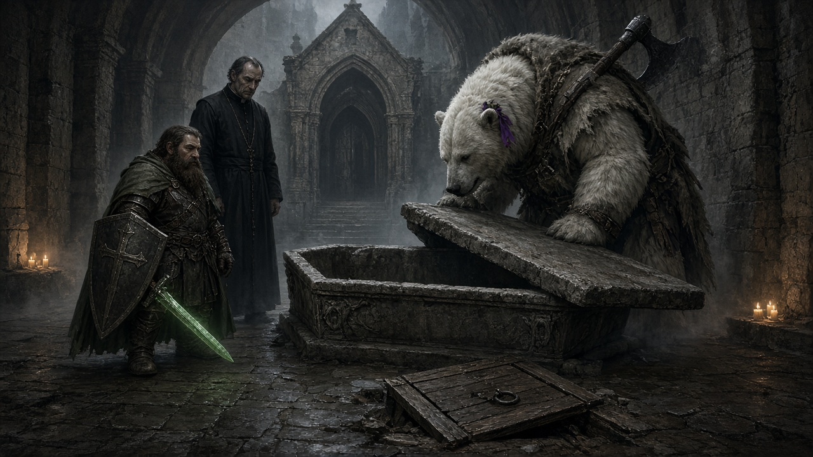
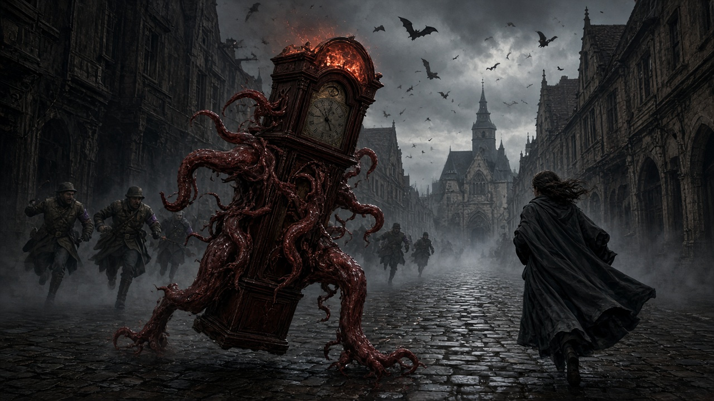
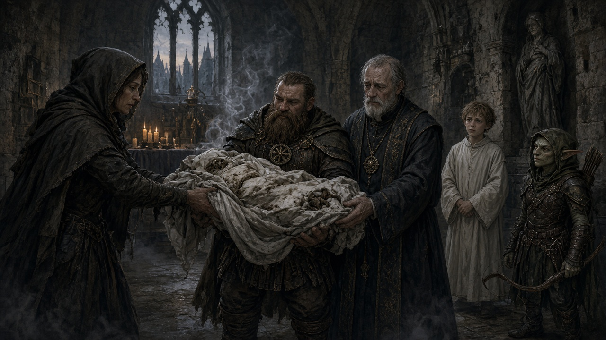

# Session 007 – Der Verlorene
**Datum:** 2026-11-27
**DM:** Jana
**Ort in der Spielwelt:** Vallaki — Kirche, Gruft, Haus des Sargmachers, Straße zurück zur Kirche

**Bilder:**

---

## Zusammenfassung
Die Kirche von Vallaki schützt nur, solange die Gebeine darin liegen. Sie liegen nicht mehr darin. Flori, Mara und Thorin holen sie beim Sargmacher und stehen vier Vampiren gegenüber, denen das Tageslicht kaum etwas ausmacht. Zurück kommen die Gebeine in einem zerknüllten Bettlaken. Alberich und der Pater betten den Verlorenen wieder zur Ruhe, und die Party behandelt die Kirche wieder als sicher. Nia und Irena haben den ganzen Tag dort gesessen und nichts davon gewusst.

---

## Die Party
| Spieler | Charakter | Rasse | Klasse | Level |
|---------|-----------|-------|--------|-------|
| Raffi | [Nia Sommerfeld](../../../charaktere/nia-sommerfeld/charakterbogen.md) | Mensch | Bard (College of Dance) | 4 |
| Felix | [Florpthyz Dread](../../../charaktere/florpthyz-dread/charakterbogen.md) | Gnom/Standuhr | Fighter (Eldritch Knight) | 3 |
| Andi | [Alberich von Steinkreis](../../../charaktere/alberich/charakterbogen.md) | Zwerg | Cleric (Domain of Light) | 3 |
| Tom | [Thorin](../../../charaktere/thorin/charakterbogen.md) | Eisbär (Nordvolk) | Barbarian | 3 |
| Svenja | [Moxie](../../../charaktere/moxi/charakterbogen.md) | Goblin | Ranger (Monster Slayer) | 3 |
| Anna | [Mara Winterried](../../../charaktere/mara/charakterbogen.md) | Mensch | Bard | 3 |

*(Reist mit: [Irena Koljana](../npcs/irena-koljana.md). Zum Sargmacher gehen nur Flori, Mara und Thorin. Nia bleibt bei Irena in der Kirche.)*

---

## Was passiert ist

### Kein Barde
> Mara hört den Barden genau hin. Die Worte sitzen. Das Bardische nicht.

*[Mara]*

In Vallaki nimmt man die Maske nicht ab. Lila Bänder, erzwungenes Lächeln. Selbst ein Jäger im bunten Narrenkleid trägt Silber, und Knoblauch hat hier jeder Dumme dabei.

[Mara](../../../charaktere/mara/charakterbogen.md) hört [Rictavio](../npcs/rictavio.md) zu, den Barden aus dem [Blauwasser](../orte/gasthaus-blauwasser.md). Wohlgesetzte Worte. Aber nicht bardisch. Sie hält ihn für keinen Barden.

### Die Kirche hält nicht
> Der Pater hat es nur Alberich und dem Messdiener gesagt. Die Gebeine sind weg, und ohne sie ist die Kirche nicht sicher.

*[Alberich, Yeska, Lucian, Mara, Moxie, Flori, Nia, Irena]*

In der [Kirche](../orte/kirche-vallaki.md) ist man nicht mehr sicher. Die Gebeine sind fort. [Pater Lucian](../npcs/lucian-petrovich.md) hat das nur Alberich und dem Messdiener gesagt, sonst niemandem.

Die Gebeine machen die Kirche sicher, solange sie **in der Kirche** liegen. Anderswo tun sie nichts.

Der Messdiener ist [Yeska](../npcs/yeska.md), ein Waisenkind mit hellbraunem Haar. Er wohnt beim Pater. Er hat große Angst, und er ist ein Plappermaul: Er verspricht sich, wo die Gebeine waren. Er hat es dem Totengräber [Milivoj](../npcs/milivoj.md) erzählt. Milivoj trägt nichts Lilanes. Er ist nicht Yeskas Bruder. Er riecht nach den Toten, was Thorin nur logisch findet.

**Moxie** hält **Mara** vom Messwein ab. Es gibt ein Problem. Mara sucht trotzdem nach einer Ausrede, ihn trinken zu dürfen.

**Flori** schärft auf Alberichs Bitte Alarm.

[Nia](../../../charaktere/nia-sommerfeld/charakterbogen.md) und [Irena](../npcs/irena-koljana.md) sitzen in derselben Kirche und halten sie für sicher. Niemand sagt ihnen, dass der Schutz weg ist. Nia passt auf Irena auf. Den Rest des Tages erfährt sie nicht.

### Die leere Gruft
> Unter der Kirche ist der Sarg offen. Die Gebeine sind weg.

*[Alberich, Thorin, Lucian]*

Unter der Kirche ist eine Gruft. Die Falltür ist **ausgehebelt**, ohne Schlüssel. Das liest Thorin. Unten steht der Sarg offen. Leer.

Thorin will an der leeren Stelle riechen und schauen, wohin die Gebeine sind. Weit kommt der Plan nicht. Der Sargmacher ist kein Geheimversteck. **Flori, Mara und Thorin** gehen einfach hin.

### Die Tür
> Sie treten die Tür ein. Die Gebeine sind im Schrank. In der Tür steht ein Vampir und sagt, das seien seine.

*[Flori, Mara, Thorin]*

Sie wollen die Gebeine, und sie wollen dem [Sargmacher](../npcs/sargmacher.md) Angst machen. Die Tür fliegt auf. Die Gebeine liegen in seinem Schrank. Als sie sie herausholen, steht ein [Vampir](../npcs/vampire-beim-sargmacher.md) in der Tür hinter ihnen. Das seien seine Gebeine. Die will er haben.

Thorin durchsucht das Haus und findet nicht, was er sucht. Flori nimmt den Sargmacher mit nach oben. Thorin schlägt ein Fenster ein, halbherzig, für Licht. Es ist Tag. Es ist nicht hell genug.

### Vier
> Aus einem werden vier. Mara klettert hinaus, Thorin springt, Flori bleibt.

*[Flori, Mara, Thorin]*

Drei weitere kommen dazu. Vier Vampire, keine Namen. Das Licht aus dem Fenster hält sie nicht auf.

Sie gehen an Flori vorbei. Einer beißt Mara, Klaue und Biss. Einer trifft Thorin, und Thorin steht trotzdem noch. Flori wirkt **Witch Bolt** auf den, der ihn angegriffen hat, und verschwindet im Schatten des [Umhangs](../items/umhang-des-waechters.md). Wer an ihm vorbeiwollt, kassiert es.

Mara klettert hinunter. Thorin sieht niemanden mehr von den Seinen im Raum, schwingt sich über die Balustrade, Beine voran, und springt. Er kommt unten an.

### Die brennende Uhr
> Die Vampire werden Fledermäuse. Flori zündet das Fenster an, sperrt den Sargmacher in den Schrank und läuft glimmend durch die Stadt.

*[Flori, Mara, Thorin]*

Flori ist allein oben. Die Vampire werden zu Fledermäusen und schweben zum Fenster. Er legt noch einmal Blitz auf einen, dann **Burning Hands** über die drei am Fenster. Die Bude brennt nicht. Das Fenster brennt. Die Gebeine sind schon draußen, der Schrank stand auf der anderen Seite.

Er geht ins Feuer, damit sie an ihm vorbei müssen. Einer haut ab. Am Fenster ist kein Schatten mehr, und der Umhang lässt ihn wieder sichtbar werden.

Unten könnte Mara noch nach den Fledermäusen schlagen. Sie rennt stattdessen zur Kirche und heilt im Laufen. Thorin sieht Flori nicht mehr, sieht Mara rennen und rennt mit. Beide schreien, dass Vampire da sind. Thorin so laut, dass die Häuser es hören.

Die **Stadtwache** kommt. Die Fledermäuse drehen ab. Mara lässt die Wachen zwischen sich und das Haus. Thorin will kein Gespräch. Er zieht sie weg.

Flori ist noch im Zimmer. Der Sargmacher ist nicht herausgekommen. Flori sperrt ihn in den Kleiderschrank, damit er verbrennt, geht die Treppe hinunter und macht die Tür zu. Sie schauen nicht nach.

Oben glimmt das harte Holz, es brennt nicht lichterloh. Trotzdem läuft eine Uhr durch Vallaki, an der es oben brennt. Thorin kippt seinen Wasserschlauch darüber. Und jetzt schnell in die Kirche. Unterwegs hält sie niemand auf.

### Der Verlorene
> In einem zerknüllten Bettlaken sind die Gebeine. Alberich und der Pater betten ihn wieder zur Ruhe.

*[Alberich, Flori, Mara, Thorin, Moxie, Nia, Irena, Lucian, Yeska]*

Sie kommen an. Moxie: *„Was ist denn mit euch passiert?“* Nicht hier. Runter, in den Keller.

Mara drückt ihnen ein zerknülltes Bettlaken in die Hand. Alberich macht es auf. *„Ah! Der Verlorene. Vater, wir hätten hier den Verlorenen.“*

Der Pater läuft damit hinunter. Alberich geht mit und bettet ihn wieder zur Ruhe: Weihrauch, heilige Flamme, im Uhrzeigersinn und dagegen. Danach behandeln sie die Kirche wieder als sicher. Die Gebeine liegen drin.

Mara will Messwein. Thorin will ein Glas und sich in der Küche schlafen legen. Moxie heilt, wer am schlimmsten aussieht. Was sie Thorin danach hinhält, spuckt er aus. *„Medizin schmeckt nicht.“* Mara, zu Moxie: der Knoblauch, den sie verkauft bekommen haben, taugt nichts. Vier Vampire, und sie sind nicht dazu gekommen, ihn zu brauchen. Das Weihwasser auch nicht. Mara gibt es Alberich zurück. Er sagt, sie solle es behalten.

Es geht auf den Abend zu, weit nach sechs.

Alberich will das Haus noch einmal segnen, die Türen verrammeln, die Verletzten hinlegen. Moxie lässt Milivoj nicht rein. Vampire brauchen eine Einladung, und ein Totengräber, der die Gebeine verraten hat, ist ihr genug. Alberich überlässt ihn der Wache.

Mara hat Alberich ein Buch geschenkt: *Warum verurteilen dich Einhörner.* Er liest drei Seiten und hält es für bunte Presse. Er gibt es Yeska. Mara ist beleidigt. Er gibt es trotzdem: der Vater habe jetzt wieder Zeit, und als Gehilfe werde der Junge lesen müssen. Vorne sind Bilder, falls er es nicht kann. Geheimnisse behalten, sagt Yeska, könne er schon. *„Das kann ich jetzt schon richtig gut.“*

Nia sitzt noch bei Irena. Was draußen passiert ist, hat ihr niemand erzählt.

---

## Entscheidungen & Konsequenzen
- Die Kirche schützt nur mit den Gebeinen darin. Yeska hat Milivoj gesagt, wo sie waren. Lucian hatte es sonst nur Alberich gesagt.
- Flori, Mara und Thorin holen die Gebeine und lassen den Sargmacher im Kleiderschrank zurück, damit er verbrennt. Sie gehen nicht zurück, um nachzusehen.
- Vier Vampire, Tageslicht hilft kaum. Sie fliehen als Fledermäuse, als Thorin in der Stadt schreit und die Wache kommt. Ob einer tot ist, sieht niemand.
- Die Gebeine kommen zurück. Das Ritual wird gesprochen. Die Party behandelt die Kirche wieder als sicher.
- Nia und Irena wissen nicht, dass sie es einen Tag lang nicht war. Nia kennt den Kampf nicht.
- Thorin hat „Vampire“ durch die Straße gebrüllt. Die Einlass-Auflage war: keine Unruhe.
- Knoblauch unbrauchbar, Weihwasser ungenutzt. Yeska hat ein Buch, das nicht für ihn war. Milivoj kommt nicht rein.

---

## NPCs diese Session
- **[Pater Lucian Petrovich](../npcs/lucian-petrovich.md)** — sagt nur Alberich und Yeska, dass die Gebeine weg sind; bettet den Verlorenen wieder zur Ruhe
- **[Yeska](../npcs/yeska.md)** — Messdiener, Waise, große Angst; hat Milivoj den Ort gesagt; bekommt am Ende ein Buch
- **[Milivoj](../npcs/milivoj.md)** — Totengräber, nichts Lilanes, nicht Yeskas Bruder; Moxie lässt ihn nicht rein
- **[Der Sargmacher](../npcs/sargmacher.md)** — Gebeine in seinem Schrank; von Flori in den Kleiderschrank gesperrt
- **[Vampire beim Sargmacher](../npcs/vampire-beim-sargmacher.md)** — vier, unbenannt; einer beansprucht die Gebeine; Flucht vor der Wache
- **Stadtwache** — kommt, weil Thorin schreit; die drei reden nicht mit ihr
- **[Rictavio](../npcs/rictavio.md)** — Mara hält ihn für keinen Barden

---

## Neue Items / Veränderungen
- **Gebeine des Verlorenen** — zurück in der Kirche, neu beigesetzt. Nicht im Besitz der Party.
- **Weihwasser** — ungenutzt; bleibt bei Mara
- **Knoblauch** — gekauft, taugt nichts, nicht eingesetzt
- **Buch *Warum verurteilen dich Einhörner*** — von Mara an Alberich, von Alberich an Yeska
- **Floris Umhang** — im Schatten unsichtbar, am Fenster wieder sichtbar

---

## Offene Fäden
- Hält die Kirche wirklich wieder, oder tun sie nur so, weil die Gebeine drin liegen?
- Wer ist der Verlorene?
- Der Sargmacher blieb im Schrank. Sie haben nicht nachgesehen.
- Die vier Vampire sind geflohen, nicht erledigt. Einer wollte die Gebeine unbedingt.
- Wer hat die Falltür ausgehebelt?
- Milivoj weiß, wo die Gebeine waren. Die Wache weiß es nicht.
- Thorin hat in der Stadt „Vampire“ gebrüllt. Hängt das an der Party?
- Nia weiß den Kampf nicht. Irena auch nicht.
- Ist Rictavio überhaupt ein Barde?
- Aus S006 weiter offen: **Fest der brennenden Sonne**, **Isek Strazni**, **Baron**, **Lady Wachter**, die **Raben**, die **Wölfe auf Irena**
- Aus S005 weiter offen: der **Thronsaal-Vampir**, das **Tagebuch**, die **schwarze Kutsche**, der **falsche Brief**, **Gertruda**

---

## Notizen
> Gespielt am 27.11.2026, kurze Freitagssession. Zwei Mitschriften, keine Aufnahme des ganzen Abends. Namen geglättet, wo dieselbe Person gemeint war: Lucian Petrovich, Yeska, Milivoj. Den Sargmacher haben sie nicht beim Namen genannt. „Der Verlorene“ bleibt, wie er gesagt wurde. Die Rohmitschriften liegen nicht im Repo.
