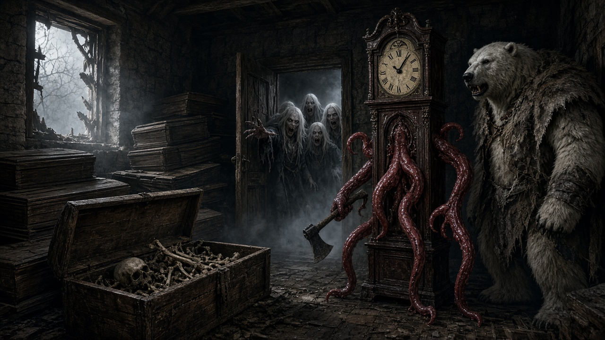

# Session 007 – Der Verlorene
**Datum:** 2026-11-27
**DM:** Jana
**Ort in der Spielwelt:** Vallaki — Kirche, Gruft unter der Kirche, Haus des Sargmachers, Straße zurück zur Kirche

**Bilder:**

---

## Zusammenfassung
Die Kirche von Vallaki schützt nur, solange die Gebeine darin liegen. Sie liegen nicht mehr darin. Flori, Mara und Thorin holen sie beim Sargmacher — und stehen vier Vampiren gegenüber, die das Tageslicht kaum stört. Sie kommen mit einem zerknüllten Bettlaken zurück. Alberich und der Pater betten „den Verlorenen“ wieder zur Ruhe. Jana sagt nicht, dass die Kirche damit wieder sicher ist. Die Party geht davon aus, weil die Gebeine wieder drin liegen.

---

## Die Party
| Spieler | Charakter | Rasse | Klasse | Level |
|---------|-----------|-------|--------|-------|
| Raffi | [Nia Sommerfeld](../../../charaktere/nia-sommerfeld/charakterbogen.md) | Mensch | Bard (College of Dance) | 4 |
| Felix | [Florpthyz Dread](../../../charaktere/florpthyz-dread/charakterbogen.md) | Gnom/Standuhr | Fighter (Eldritch Knight) | 3 |
| Andi | [Alberich von Steinkreis](../../../charaktere/alberich/charakterbogen.md) | Zwerg | Cleric (Domain of Light) | 3 |
| Tom | [Thorin](../../../charaktere/thorin/charakterbogen.md) | Eisbär (Nordvolk) | Barbarian | 3 |
| Svenja | [Moxie](../../../charaktere/moxi/charakterbogen.md) | Goblin | Ranger (Monster Slayer) | 3 |
| Anna | [Mara Winterried](../../../charaktere/mara/charakterbogen.md) | Mensch | Bard | 3 |

*(Alle sechs am Tisch. Zum Sargmacher gehen nur **Flori, Mara und Thorin**. [Nia](../../../charaktere/nia-sommerfeld/charakterbogen.md) und [Irena](../npcs/irena-koljana.md) bleiben in der Kirche. Beide wissen nicht, dass der Schutz weg ist. Nia passt auf Irena auf, emotionaler Beistand, und weiß bis danach nicht, was draußen passiert ist — es hat ihr noch niemand erzählt.)*

---

## Was passiert ist

### Die Maske bleibt auf
> Mara hört den Barden genau hin: gewählte Worte, aber nicht bardisch. Sie hält ihn für keinen Barden.

*[Mara]*

Oben in den Notizen stehen zwei Zeilen, Sprecher nicht festgehalten:

> „Wo lila Bänder Zwang und Lächeln binden, da lohnt es sich nicht, die Maske abzunehmen.“
> „Selbst ein Jäger, bunt im Narrenkleid, trägt Silber.“

Die Notiz setzt dazu: selbst der Dumme hat Silber und Knoblauch dabei.

[Mara](../../../charaktere/mara/charakterbogen.md) merkt, dass **der Barde** sehr wohlgesetzte Worte nutzt, aber nicht wirklich bardisch. Sie denkt, er sei gar kein Barde. Gemeint ist, soweit die Notiz das hergibt, [Rictavio](../npcs/rictavio.md) aus dem [Blauwasser](../orte/gasthaus-blauwasser.md) — der einzige Barde, den die Party in Vallaki kennt. Ein neues Gespräch mit ihm steht nicht in der Mitschrift.

### Die Kirche ist nicht mehr sicher
> Der Pater hat es nur Alberich und dem Messdiener gesagt: ohne die Gebeine ist die Kirche nicht sicher. Und die Gebeine sind weg.

*[Alberich, Yeska, Lucian; danach Mara, Moxie, Flori]*

In der [Kirche](../orte/kirche-vallaki.md) ist man nicht mehr sicher. Die Gebeine des Heiligen sind fort. [Pater Lucian Petrovich](../npcs/lucian-petrovich.md) — in der Mitschrift „Petrociv Lucian“ — hat das **nur Alberich und dem Messdiener** erzählt, sonst niemandem.

Was die Party daraus mitnimmt: Die Gebeine machen die Kirche **genau dann** sicher, wenn sie **in der Kirche** sind. Anderswo machen sie nichts sicher. **Nia und Irena erfahren das an dem Tag nicht.** Sie sitzen in der Kirche und halten sie für sicher.

Der Messdiener ist [Yeska](../npcs/yeska.md) — in der Mitschrift „Jeskar“: das Waisenkind, der Junge mit dem hellbraunen Haar. Er wohnt beim Pater. Er hat große Angst. Und er ist ein Plappermaul: Er verspricht sich, die Gebeine seien „da und da“.

**Moxie** sagt **Mara**, dass es ein Problem gibt — just als Mara den Messwein trinken will. Mara will die ganze Zeit Wein und sucht Ausreden, dass sie das darf.

**Flori** schärft auf Alberichs Bitte **Alarm**. Worauf, sagt die Notiz nicht.

### Die offene Gruft
> Unter der Kirche ist der Sarg offen. Thorin will riechen, wohin die Gebeine gegangen sind.

*[Alberich, Thorin, Lucian]*

Unter der Kirche ist eine Gruft. **Alberich**, **Thorin** und der Pater gehen hinunter. Der Sarg ist offen. Keine Gebeine mehr darin.

Die Falltür hatte Spuren: jemand hat sie **ausgehebelt**, ohne Schlüssel. Das liest Thorin. Sein Plan: an der leeren Stelle riechen und schauen, wohin die Gebeine sind.

### Milivoj
> Der Totengräber trägt nichts Lilanes. Yeska hat es ihm erzählt. Er ist nicht sein Bruder.

*[unbelegt, wer das Gespräch führt]*

[Milivoj](../npcs/milivoj.md) — in der Mitschrift „Milivoi“, später am Tisch „Miniboy“ — hebt die Gräber aus. Er hat **nichts Lilanes** an. Er riecht nach toten Menschen, was Thorin nur logisch findet. **Yeska ist nicht sein Bruder.** Yeska hat ihm erzählt, wo die Gebeine sind.

Wie die drei vom Plan „riechen“ zum Haus kommen, steht in den Mitschriften nicht. Nachgefragt: kein Geheimversteck. Flori, Mara und Thorin sind einfach hingegangen.

### Die Tür des Sargmachers
> Flori, Mara und Thorin treten die Tür ein. Die Gebeine sind im Schrank — und in der Tür steht ein Vampir, der sagt, das seien seine.

*[Flori, Mara, Thorin]*

**Flori, Mara und Thorin** gehen zum [Sargmacher](../npcs/sargmacher.md), um die Gebeine zu holen und ihm Angst zu machen. Sie schlagen die Tür ein. Einen Namen hat er in den Notizen nicht.

Die Gebeine sind anscheinend in seinem Schrank. Als sie sie herausholen, steht in der Tür hinter ihnen ein [Vampir](../npcs/vampire-beim-sargmacher.md) und sagt, das seien **seine** Gebeine, die er unbedingt haben will.

Thorin hat versucht, alles zu durchsuchen. Das hat nicht gut funktioniert. Also nimmt Flori den Sargmacher mit nach oben. Thorin schlägt ein Fenster **halbherzig** ein, für Licht. Es ist Tageslicht, aber nicht wirklich hell. Es bringt nicht viel.

### Vier Vampire
> Aus einem werden vier. Tageslicht hält sie nicht auf. Mara klettert, Thorin springt, Flori bleibt.

*[Flori, Mara, Thorin]*

Drei weitere Vampire kommen dazu. Es sind vier. Die Nummern stehen so in der Mitschrift; Namen haben sie keine.

- **Nummer 2** greift Flori mit den Klauen an.
- **Nummer 4** geht an Flori vorbei auf Thorin zu. Der erste Angriff trifft nicht. Der zweite: **9 physisch und 7 nekrotisch**.
- **Flori** wirkt **Witch Bolt** auf den, der ihn angegriffen hat, und macht sich mit dem [Umhang des Wächters](../items/umhang-des-waechters.md) unsichtbar. **Action Surge**, noch ein Angriff mit Advantage, weil unsichtbar. Den Schaden dieses Schlags hat die Notiz nicht.
- **Nummer 3** geht an Flori vorbei — Gelegenheitsangriff mit Advantage, **7 Schaden** — zu Mara. Biss: **5 Stich und 7 nekrotisch**. Klaue: **10 physisch**.
- Der Nächste geht ebenfalls an Flori vorbei zu Thorin und kassiert einen **kritischen** Gelegenheitsangriff, **23 Schaden**. Thorin kassiert trotzdem **6 Stich, 7 nekrotisch und noch einmal 9 Stich**.

**Mara** klettert hinunter. **Thorin** sieht niemanden mehr im Raum, macht Rückzug, schwingt sich über die Balustrade, Beine voran, und springt. Athletik **22**. Er kommt unten an, ohne dass der Sturz ihn umhaut. Die Musik, die er noch hatte, war in der Luft — unten nicht mehr.

### Brennende Uhr
> Die Vampire werden Fledermäuse. Flori zündet das Fenster an, sperrt den Sargmacher in den Schrank und läuft brennend durch die Stadt. Thorin löscht ihn mit dem Wasserschlauch.

*[Flori, Mara, Thorin]*

Flori ist der Einzige, der noch im Raum ist. Die Vampire werden zu **Fledermäusen** und schweben zum Fenster. Einer kassiert dabei noch einen Gelegenheitsangriff, **4 Schaden**.

Flori legt dem, der ihn angegriffen hatte, noch einmal **Witch Bolt** auf: **9 Blitz**. Dann **Burning Hands** auf die drei am Fenster, Geschicklichkeitssicherheitswurf 13. Einer schafft ihn nicht, zwei schaffen ihn. **11 Feuer** für den einen, **5** für die beiden anderen. Die ganze Bude brennt nicht. Das **Fenster** brennt. Der Schrank mit den Gebeinen — „ein heiliger Schrank“ — stand auf der anderen Seite.

Flori geht ins Feuer, damit die Fledermäuse im Nahkampf sind und er eine Reihe Gelegenheitsangriffe bekommt. Einer will los, **Natural 20**, **14 Schaden**, Flori dabei noch unsichtbar. Einer haut ab; der Gelegenheitsangriff trifft nicht. Am Fenster ist Flori nicht mehr im Schatten. Der Umhang hält ihn nicht mehr unsichtbar.

Unten hat Mara grundsätzlich Zugriff auf drei der Fledermäuse. Sie rennt trotzdem Richtung Kirche, zweimal neun Meter, und wirkt im Laufen **Heilendes Wort**. Die Würfel dafür sind in der Mitschrift ein Durcheinander; den Modifier vergisst sie erst und rechnet ihn nach. Thorin sieht Flori oben nicht mehr, sieht Mara rennen und rennt mit, **24 Meter**, Richtung Kirche. Beide schreien, dass Vampire da sind. Thorin brüllt es so, dass die Häuser es hören.

Der letzte Vampir bei Flori will auch raus und kassiert noch **4 Schaden**.

Weil Thorin geschrien hat, kommen **Stadtwachen** angerannt. Die Vampire laufen weg. Mara wartet, bis die Traube Wachen zwischen ihr und dem Geschehen ist, und sieht die Fledermäuse abdrehen — sofern sie sich in Sicherheit wiegt. Thorin will kein Gespräch mit der Wache. Er zieht Mara weg.

Flori ist noch im brennenden Zimmer. Der Sargmacher ist nie herausgekommen. Flori sperrt ihn in seinen **Kleiderschrank** und verriegelt den, damit er verbrennen kann. Dann die Treppe hinunter, die Tür hinter sich zu. Ob er tot ist, sagt niemand. Raffi geht sehr stark davon aus, dass er das nicht überlebt hat. Nia weiß davon nichts.

Oben glimmt das harte Holz, es brennt nicht lichterloh. Trotzdem läuft eine Uhr durch die Stadt, an der es oben brennt. Thorin kippt seinen **Wasserschlauch** darüber. Gut gemacht. Und jetzt schnell in die Kirche. Unterwegs passiert nichts mehr.

### Der Verlorene kommt zurück
> In einem zerknüllten Bettlaken sind die Gebeine. Alberich und der Pater betten ihn wieder zur Ruhe. Mara will Messwein. Yeska bekommt ein Buch, das nicht für ihn war.

*[Alberich, Flori, Mara, Thorin, Moxie, Nia, Irena, Lucian, Yeska]*

Sie kommen an. In der Kirche sind **Nia und Irena** geblieben. Moxie: *„Was ist denn mit euch passiert?“* Nicht hier. Runter, in den Keller. Nia erfährt es auch danach nicht. Es hat ihr noch niemand erzählt.

Mara fumelt ein **zerknülltes Bettlaken** heraus und drückt es ihnen in die Hand. Alberich macht es auf. *„Ah! Der Verlorene. Vater, wir hätten hier den Verlorenen.“* So heißt er in der Mitschrift. Ob das sein Name ist oder eine Verballhornung, ist nicht aufgelöst — die Notizen ersetzen ihn nicht stillschweigend durch einen anderen.

Der Pater läuft damit hinunter. Alberich begleitet ihn und bettet den Verlorenen wieder zur Ruhe: Weihrauch, heilige Flamme, im Uhrzeigersinn und gegen den Uhrzeigersinn, „volle Lotte“. Mara will **Messwein**. Thorin will ein Glas Wein und sich irgendwo in der Küche schlafen legen.

Moxie fragt, wer am schlimmsten aussieht, und heilt Thorin mit einer Berührung. Was sie ihm danach ins Gesicht hält, spuckt er aus. *„Medizin schmeckt nicht.“* Mara, zu Moxie: der Knoblauch, den sie verkauft bekommen haben, sei **nicht funktionsfähig**. Vier Vampire. Zum Essen, Einschmieren oder sonst etwas sind sie nicht gekommen. Das **Weihwasser** haben sie auch nicht gebraucht. Mara gibt es Alberich zurück; er sagt, sie solle es behalten. Am Tisch ist danach klar, dass man es den Vampiren hätte überstreuen können.

Es geht auf den Abend zu. Nachmittag, weit nach sechs, sagt die Spielleitung.

Alberichs Vorschlag: das Haus noch einmal segnen, die Gebete sprechen, die Türen verrammeln, sich für die Nacht wappnen. Die Verletzten sollen sich hinlegen. Moxie: Vampire brauchen eine Einladung. Den Totengräber würde sie nicht reinlassen. Alberich: das sei Sache der Stadtwache, nicht seine. Reinlassen ist die andere Frage. Er lässt ihn nicht als erledigt gelten, aber auch nicht als seine Gerichtsbarkeit.

Mara schenkt Alberich ein Buch: *Warum verurteilen dich Einhörner.* Er überfliegt die ersten Seiten. Es ist Blabla, bunte Presse. Er will es Yeska geben. Mara ist beleidigt — so geht man nicht mit Geschenken um. Er gibt es ihm trotzdem: der Vater habe jetzt vielleicht wieder mehr Zeit, und als Gehilfe werde der Junge lesen müssen. Yeska kann es vielleicht nicht. Vorne sind Bilder. Und Geheimnisse, sagt Mara, könne er schon behalten. *„Das kann ich jetzt schon richtig gut.“*

Die Spielleitung schließt die fast tödliche Session.

---

## Entscheidungen & Konsequenzen
- Die Kirche ist **nicht sicher**, solange die Gebeine fehlen. Die Party weiß: sie wirken **nur in der Kirche**, nirgendwo sonst.
- Pater Lucian hat das **nur Alberich und Yeska** gesagt. Yeska hat es **Milivoj** erzählt.
- Flori schärft auf Alberichs Bitte Alarm. Ziel nicht notiert.
- Flori, Mara und Thorin **treten die Tür des Sargmachers ein**, nehmen die Gebeine und den Sargmacher mit nach oben. Kein Geheimversteck: die drei sind einfach hingegangen. Nia und Irena waren nicht dabei.
- Kampf gegen **vier Vampire**. Tageslicht hilft kaum. Keiner der vier ist in den Notizen als zerstört markiert. Sie fliehen als Fledermäuse, als die Wache kommt.
- Thorin **schreit in der Stadt „Vampire“**. Die Wache kommt. Die Party redet nicht mit ihr und kommt ohne weiteren Zwischenfall in der Kirche an. Ob das die Einlass-Auflage „keine Unruhe“ bricht, ist offen.
- Flori sperrt den Sargmacher in den **Kleiderschrank**, damit er verbrennt. Das Fenster brennt, nicht belegt die ganze Bude. Tod nicht bestätigt. Raffi nimmt ihn als tot an.
- Die Gebeine kommen in einem Bettlaken zurück. Alberich und der Pater sprechen das Ritual. **Jana sagt nicht, dass die Kirche wieder sicher ist.** Die Party geht davon aus, weil die Gebeine wieder drin liegen. Nia und Irena wissen nicht, dass sie es je nicht war.
- Knoblauch unbrauchbar, Weihwasser ungenutzt. Beides hätte in den Kampf gehört und kam nicht dran.
- Yeska bekommt Maras Buch an Alberich. Milivoj soll nicht in die Kirche. Die Nacht wird verrammelt.

---

## NPCs diese Session
- **[Pater Lucian Petrovich](../npcs/lucian-petrovich.md)** — sagt nur Alberich und Yeska, dass die Gebeine weg sind; geht mit in die Gruft; bettet den Verlorenen wieder zur Ruhe
- **[Yeska](../npcs/yeska.md)** — Waisenkind, Messdiener, wohnt beim Pater, große Angst, verspricht sich den Ort der Gebeine, hat es Milivoj erzählt
- **[Milivoj](../npcs/milivoj.md)** — Totengräber, nichts Lilanes, nicht Yeskas Bruder; Moxie will ihn nicht reinlassen
- **[Der Sargmacher](../npcs/sargmacher.md)** — Name nicht gefallen; Gebeine in seinem Schrank; von Flori in den Kleiderschrank gesperrt
- **[Vampire beim Sargmacher](../npcs/vampire-beim-sargmacher.md)** — vier, unbenannt; einer beansprucht die Gebeine; Tageslicht stört sie kaum; Flucht als Fledermäuse vor der Wache
- **Stadtwache von Vallaki** — kommt, weil Thorin schreit; die Party spricht nicht mit ihr
- **[Rictavio](../npcs/rictavio.md)** — nicht neu getroffen, soweit die Notizen reichen; Mara hält den Barden für keinen Barden

---

## Neue Items / Veränderungen
- **Gebeine des Verlorenen** — aus dem Schrank des Sargmachers, im Bettlaken zurück in die Kirche, neu beigesetzt. Nicht im Besitz der Party.
- **Weihwasser** — ungenutzt; Alberich sagt, Mara solle es behalten
- **Knoblauch** — gekauft, nach Maras Urteil nicht funktionsfähig, nicht eingesetzt
- **Buch *Warum verurteilen dich Einhörner*** — von Mara an Alberich, von Alberich an Yeska. Witzgeschenk, keine Notiz dass es magisch wäre
- **Floris Umhang** — Unsichtbarkeit im Schatten eingesetzt; am Fenster, außer Schatten, wieder sichtbar. Ob die einmal-pro-Tag-Ladung damit verbraucht ist, steht so nicht da, folgt aber aus dem Gegenstand

---

## Offene Fäden
- Ist die Kirche **wieder sicher**? Jana hat es nicht gesagt. Die Party geht davon aus, weil die Gebeine wieder drin liegen.
- Wer ist **der Verlorene** — Name oder nur das, was die Mitschrift daraus gemacht hat?
- Lebt der **Sargmacher**? Nicht bestätigt. Raffi geht sehr stark davon aus, dass der Schrank ihn nicht überlebt hat. Nia weiß es nicht.
- Sind die **vier Vampire** weg oder nur geflohen? Einer wollte die Gebeine unbedingt.
- Wer hat die Falltür **ausgehebelt** — Milivoj, der Sargmacher, die Vampire, jemand anders?
- **Milivoj** weiß, wo die Gebeine waren. Kommt er wieder? Moxie lässt ihn nicht rein. Die Wache ist, nach Alberich, zuständig.
- Thorin hat in der Stadt **„Vampire“** gebrüllt. Kommt die Wache darauf zurück? Einlass-Auflage: keine Unruhe.
- **Nia und Irena** waren in der Kirche und hielten sie für sicher. Nia hat auf Irena aufgepasst. Was draußen passiert ist, weiß Nia noch nicht — es hat ihr niemand erzählt.
- **Rictavio** — Mara hält ihn für keinen Barden. Silber und Knoblauch beim bunten Jäger: Beobachtung, nicht bestätigt.
- In der Kurzmitschrift ein ungeklärter Name **„Jester“**, der nie gewusst habe, dass „die Gemeinde“ weg sei. In der zweiten Mitschrift kommt beides nicht vor. Nicht als Person übernommen.
- Aus S006 weiter offen: **Fest der brennenden Sonne** (Countdown in diesen Notizen nicht fortgeschrieben), **Isek Strazni**, **Baron**, **Lady Wachter**, die **Raben**, die **Wölfe auf Irena**
- Aus S005 weiter offen: der **Thronsaal-Vampir**, das **Tagebuch**, die **schwarze Kutsche**, der **falsche Brief**, **Gertruda**

---

## Notizen
> Gespielt am 27.11.2026, kurze Freitagssession. Grundlage sind **zwei Mitschriften**, keine Aufnahme der ganzen Session und kein Modultext.
>
> Die eine ist eine Kurzmitschrift und deckt den Abend von den lila Bändern bis zum Einsperren des Sargmachers. Die andere ist eine Sprach-zu-Text-Mitschrift und setzt **mitten im Kampf** ein, als Mara aus dem Fenster steigt. Die erste Hälfte des Abends steht nur in der Kurzmitschrift.
>
> Nachgefragt am selben Abend: Zum Sargmacher sind nur die drei gegangen, kein Geheimversteck. Nia und Irena waren in der Kirche, beide ohne zu wissen, dass der Schutz weg ist. Nia weiß das Draußen immer noch nicht. Jana hat die Kirche nicht für sicher erklärt; die Party nimmt es an. Den Sargmacher hält Raffi für tot, belegt ist es nicht.
>
> Namen gegen das Modul geglättet, wo die Mitschrift eindeutig dieselbe Person meint: Petrociv Lucian → **Lucian Petrovich**, Jeskar → **Yeska**, Milivoi / Miniboy → **Milivoj**. Den Sargmacher haben sie nicht beim Namen genannt; der bleibt ohne Namen. „Der Verlorene“ bleibt, wie er gesagt wurde.
>
> Den Spieltag in der Welt datieren die Mitschriften nicht. Inhaltlich ist es der Kirchgang, der nach S006 anstand. Der Countdown zum Fest der brennenden Sonne wird hier nicht stillschweigend um einen Tag gekürzt.
>
> Die Rohmitschriften liegen nicht im Repo. Wie bei S006.
